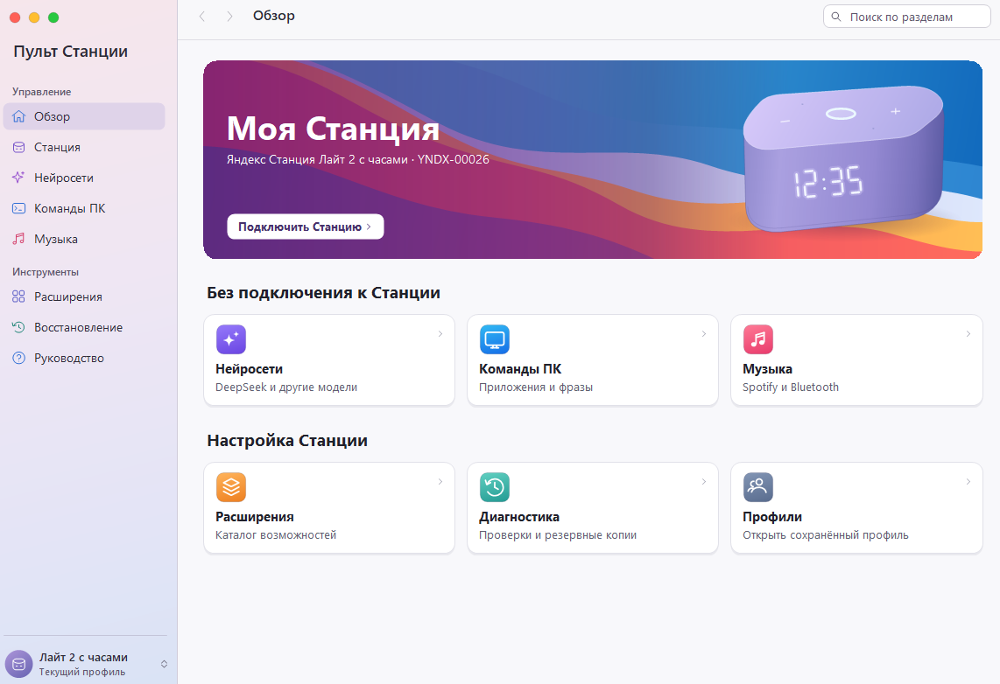

# Пульт Станции

Приложение для Windows 10 x64 и Яндекс Станции Лайт 2 с часами (YNDX-00026). Оно объединяет текстовый чат с DeepSeek, команды для домашнего ПК, музыку через аудиовыход Windows и обслуживание подготовленной колонки. Программа запускается без колонки и прав администратора.

**[Скачать установщик для Windows x64](https://github.com/sunakle/alice-software/releases/latest/download/StantsiyaDesk-Setup-x64.exe)** · [Переносимая сборка](https://github.com/sunakle/alice-software/releases/latest/download/StantsiyaDesk-portable-x64.zip) · [Контрольные суммы](https://github.com/sunakle/alice-software/releases/latest/download/SHA256SUMS.txt)

## Первый запуск

1. Запусти установщик. В меню «Пуск» появится **Пульт Станции**.
2. На экране **Обзор** нажми **Нейросети**. Укажи свой ключ DeepSeek, загрузи модели, выбери модель и задай вопрос. Генерация может расходовать баланс провайдера.
3. В разделе **Команды ПК** разреши целевой файл Chrome и проверь фразу **открой хром** кнопкой. Для приёма команд, произнесённых у Станции, отдельно подключается голосовой источник и Home Assistant.
4. В разделе **Музыка** выбери выход Windows и проверь короткий сигнал. После сопряжения со Станцией включи музыку в Spotify и отдельно укажи этому приложению нужный выход.
5. Когда друг вернёт прошитую колонку, открой **Станция** и запусти инвентаризацию по SSH или ADB в своей домашней сети.

В приложении используется светлое оформление в стиле macOS Big Sur. Поиск в верхней панели находит разделы по названию и словам вроде «Spotify» и «SSH». Для поиска нажми Ctrl+K, для перехода между уже открытыми разделами — Alt+← или Alt+→. Текущий профиль выбирается внизу боковой панели.



## Что входит

| Раздел | Что можно сделать |
|---|---|
| Профили | Создать, переключить, переименовать, скопировать, импортировать и экспортировать настройки. Ключи защищены Windows DPAPI CurrentUser. Локальные разрешения остаются в исходном профиле. |
| Нейросети | Выбрать DeepSeek, совместимый API или локальный сервер, запросить модели, отправить сообщение, остановить генерацию, начать новый диалог. Отдельная настройка голосовых маршрутов. |
| Команды ПК | Назначить приложения, HTTPS-сайты и медиаклавиши на фразы. Разрешить конкретные действия текущему пользователю. Подключить Home Assistant и включить агент при входе в Windows. |
| Музыка | Открыть клиент или веб-плеер Spotify, Bluetooth и настройки вывода. Проверить слышимость на выбранном устройстве. |
| Станция | Проверить указанный адрес и порт, доверие SSH или выбранный ADB-сеанс. Прочитать фактические параметры платы, прошивки и служб. Отправить тестовую фразу при наличии совместимого Quasar. |
| Расширения | Найти функцию, посмотреть модель из источника, её зависимости, конфликты, способ проверки и возврата. Для переднего дисплея есть локальный макет часов. |
| Восстановление | Обезличенная диагностика, ограниченные операции с резервными копиями и проверка совместимости перед изменениями. |

## Сборка из исходников

Требуются Windows x64, Windows PowerShell 5.1 и .NET Framework 4.7.2 или новее с системным 64-разрядным компилятором C# 5. На Windows 10 22H2 подходит встроенный Framework 4.8 или установленный 4.8.1. Внешних пакетов NuGet, загрузок SDK и платных сервисов для сборки нет. Из корня чистой копии репозитория выполни:

```powershell
powershell -NoProfile -ExecutionPolicy Bypass -File .\build.ps1 -Test
```

В каталоге `dist` появятся установщик, переносимый ZIP, `SHA256SUMS.txt` и два отчёта. Параметр ExecutionPolicy действует только для запущенного процесса сборки. Для проверки скачанного файла выполни `Get-FileHash .\StantsiyaDesk-Setup-x64.exe -Algorithm SHA256` и сверь значение с файлом выпуска. Установщик рассчитан на текущую учётную запись. Автозапуск включается владельцем в разделе команд. Переносимому варианту также доступно локальное хранилище профилей этой учётной записи.

[Руководство владельца](docs/owner.md) · [Подключение и диагностика](docs/device.md) · [Нейросети](docs/ai.md) · [Настройка Spotify и команд](docs/media.md) · [Пример Home Assistant](docs/home-assistant.md) · [Отчёт о проверках](docs/verification.md) · [Источники и лицензии](LICENSE-materials.md).
